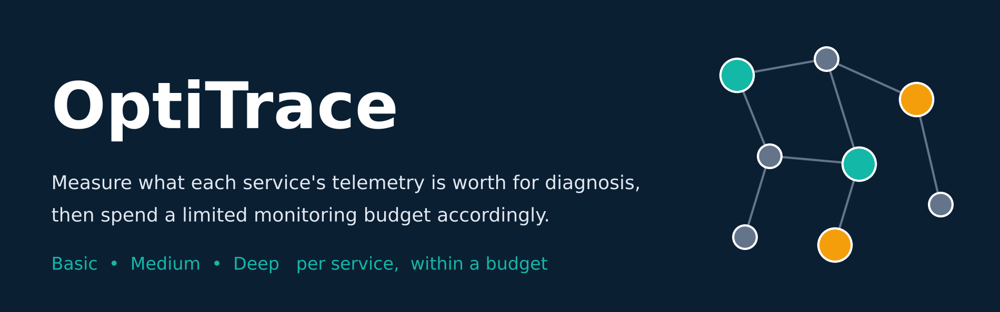
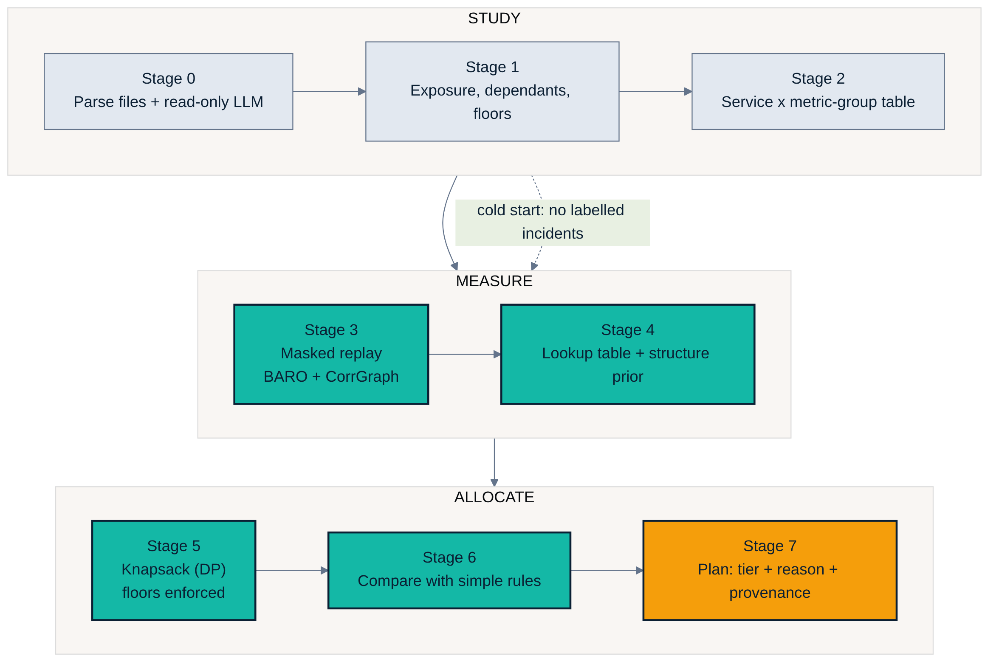
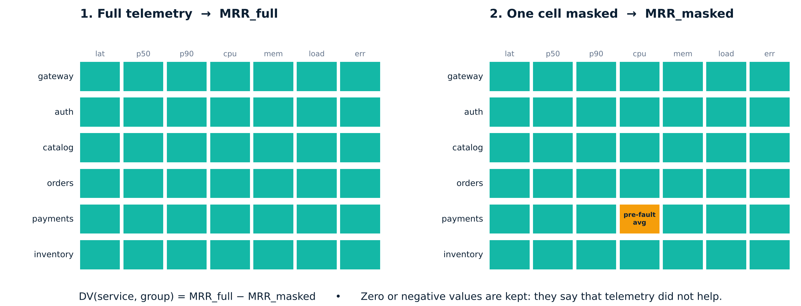
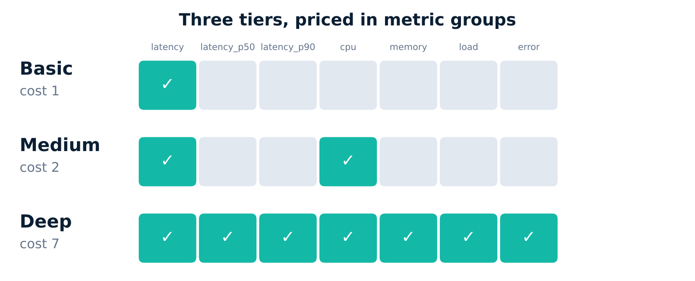

<p align="center">
  
</p>

<p align="center">
  
  
  
  
</p>

**OptiTrace** helps a team decide *how much monitoring each microservice should get* when the budget is limited. Instead of guessing, it measures how much each service's telemetry actually helps root cause analysis (RCA), then picks a **Basic**, **Medium** or **Deep** tier for every service within the budget. Every tier comes with a reason.

> Final-year research project: W.B. Jehan Ravishka Fernando, Informatics Institute of Technology (University of Westminster).

---

## Why this exists

Telemetry (metrics, logs, traces) is how engineers find the faulty service when something breaks. But keeping all of it costs storage, network and runtime, and heavy monitoring can slow the system itself. So teams give some services deep monitoring and others only the basics, and they usually decide this by judgement.

The risk is simple: **an RCA tool cannot find a culprit whose data was never collected.**

OptiTrace asks a measurable question instead:

> *How much does each service's telemetry improve diagnosis, and how should a limited budget be spent because of it?*

---

## How it works

<p align="center">
  
</p>

| Stage | What it does |
|---|---|
| **0. Parse** | Parsers read Docker Compose, Kubernetes, Terraform and README files. A **read-only** language model (no tools) fills gaps, with an evidence check. An engineer approves every fact. |
| **1. Profile and floors** | Scores each service on exposure and dependants. The engineer sets **floors**: minimum tiers (for example, *payments is at least Medium*). |
| **2. Table** | Builds the service × metric-group table that Stage 3 fills in. |
| **3. Measure** | **Masked replay** (see below) with two RCA methods, BARO and CorrGraph. |
| **4. Estimate** | A lookup table (fault type × metric group) plus a structure prior (dependants, centrality, depth) estimates cells that were not measured. A learned estimator is an *optional extra*, kept only if it beats the lookup table on held-out systems. |
| **5. Allocate** | A multiple-choice knapsack, solved by dynamic programming, picks one tier per service within budget, never below a floor. |
| **6. Validate** | Compares the plan against simple rules at the same budget. |
| **7. Plan** | Outputs each service's tier, **reason**, and **provenance** (measured, predicted, or engineer-confirmed). |

If there are no labelled incidents, a **cold-start path** skips Stage 3 and builds the plan from structure alone. Every cell is then marked *predicted*.

### The measurement: masked replay

<p align="center">
  
</p>

For one service and one metric group, the recorded fault window is re-run with that cell replaced by the service's **pre-fault average**. The RCA tool still gets a complete input, so it still runs. The value of that cell is:

```
DV(service, group) = MRR_full − MRR_masked
```

A large drop means the telemetry mattered. A drop near zero means it did not. **Zero and negative values are kept**, because they are informative.

Masking is per cell, not per whole service. A placebo mask is run as a control. Because two services can carry the same signal, hiding either alone may under-state both, so the top candidates are also tested **in pairs** and flagged when the joint drop is larger than the sum of the single drops.

### The tiers

<p align="center">
  
</p>

Cost is counted in **metric groups**, not raw metrics. Logs and traces as a cost are out of scope.

---

## RCA methods

| Method | What it is |
|---|---|
| **BARO** | A published, metric-based RCA algorithm. The main method for measuring value. |
| **CorrGraph** | **My own** correlation-graph scorer, written as a second method for cross-checking. It is *not* a published tool. It is simple and mine, so it is used as a cross-check, not as a benchmark. |

Using two methods tests whether a service's value is a property of the service or only of one RCA tool.

---

## Evaluation

Planned experiments (the decision rule is written down **before** the final runs):

| ID | Question |
|---|---|
| **E1** | Ground truth: faults injected into every service, 10 repeats each, with a placebo mask. |
| **E2** | Allocation (essential): does the value-based plan beat simple rules at the same budget? |
| **E3** | Estimation: can the table be predicted for unseen services from structure? |
| **E4** | Cross-method: does a plan built with BARO hold up under CorrGraph? |
| **S1** | Stage 0: how many context fields does the parser-plus-language-model route recover, against hand-written context? |
| **E5** | Unseen system (stretch). |

**Decision gate:** the plan must beat the best simple rule by **+0.05 MRR**. If it only ties, that is what gets reported, and the contribution is then the method and the evidence, not a win.

Metrics: MRR, top-1, top-3, Avg@5, and the smallest budget that keeps 90% of full accuracy.

**Simple rules compared against** (all reported): uniform, random (averaged over seeds), highest-volume-first, fixed latency-and-CPU, structure-only (PageRank), criticality-only, and RCA-score.

---

## Data

| Source | Role | Status |
|---|---|---|
| **Testbed** | A 10-service microservice system with injected faults in *every* service. Built as an ordinary system from standard practice. The design, faults and metrics are fixed before runs and are not tuned to favour the method. | Planned for this repository |
| **RCAEval** (MIT licence) | Public benchmark for cross-system checks. Only five services per system are faulted, which is why a testbed is also needed. | Planned. Earlier feasibility tests were withdrawn for incomplete fault coverage. |

Planned fault types: CPU stress, latency injection, and packet-loss errors. Every injection is logged (service, fault type, time, repeat). Repeats of one fault are never split between training and testing.

---


## Status

| Component | State |
|---|---|
| Design, scope and evaluation plan | Done |
| Stage 3 masked replay (per cell, placebo, pairwise) | Planned |
| Stage 5 allocator (DP, floors, checked against exhaustive search) | Planned |
| Stage 6 comparison against simple rules | Planned |
| Stage 4 estimation | Planned |
| Stage 0 discovery | Planned |
| Stage 7 plan output and cold-start path | Planned |
| Command-line interface, then a simple web UI | Planned |

---

## Planned usage

```bash
python -m optitrace run    --config config.yaml --budget 35
python -m optitrace run    --config config.yaml --budget 35 --cold-start
python -m optitrace replay --cases data/testbed/cases --k 3
python -m optitrace eval   --budget 35
```

Stage 0 uses a **local** language model (Ollama) by default, so repository text never leaves the machine. An API model can be switched on, with a printed warning.

---

## Responsible use

- **No personal data.** RCAEval is used under its MIT licence. The testbed is built for this project.
- **The language model is read-only**, has no tools, and every extracted fact needs a source and an engineer's approval. Repository text can mislead a model, so a test file with a deliberate prompt-injection comment checks that it is ignored.
- **A wrong tier could leave a critical service under-watched.** That is why engineers confirm floors and every plan states *why*.
- Negative and tied results are reported. AI assistance is disclosed.
- Reasons are written in plain language so non-specialists can read them.

---

## Limitations

- Offline replay only. No live production injection.
- The testbed is built for this project and may not reflect the correlation structure of real production systems.
- Value is measured for two RCA methods, and one of them is my own. No general claim is made.
- Single-cell masking can **under-value redundant services**. Pairwise tests reduce this but do not remove it.
- Replay is an approximation of what happens when data is never collected.
- Results are preliminary until the final runs.

---

## Project layout (planned)

```
optitrace/
├── README.md
├── config.yaml            tier costs, budgets, engine settings
├── optitrace/
│   ├── pipeline/          stage0 … stage7
│   ├── rca/               BARO wrapper, CorrGraph
│   ├── allocation/        knapsack (DP)
│   └── cli.py
├── testbed/               services, fault injection, injection log
├── data/                  cases, results
├── docs/images/           figures used in this README
└── tests/                 allocator, masking, prompt-injection, leakage checks
```

---

## References and licence

BARO and RCAEval are used under their own licences (see their repositories). All other code is written for this project. Released under the **MIT licence**.

<sub>Author: Jehan Fernando · Contact: 02jehanfernando@gmail.com · </sub>
